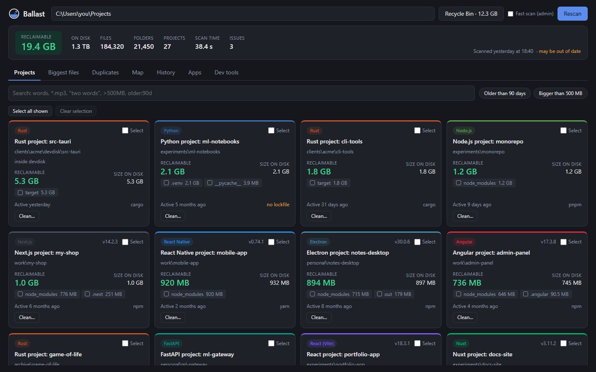
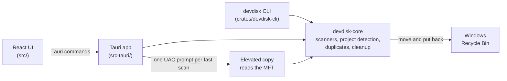
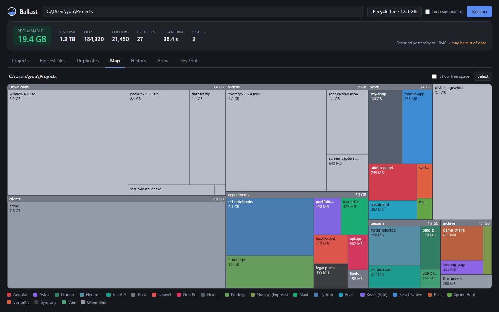
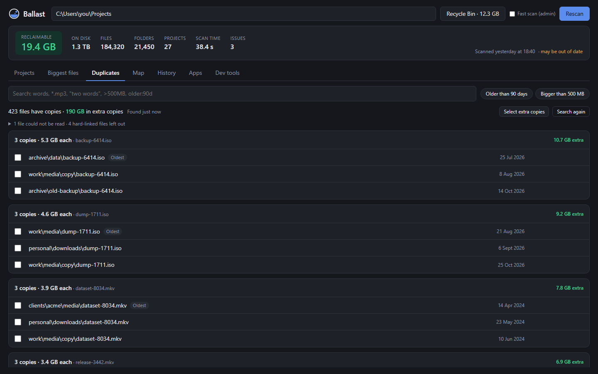
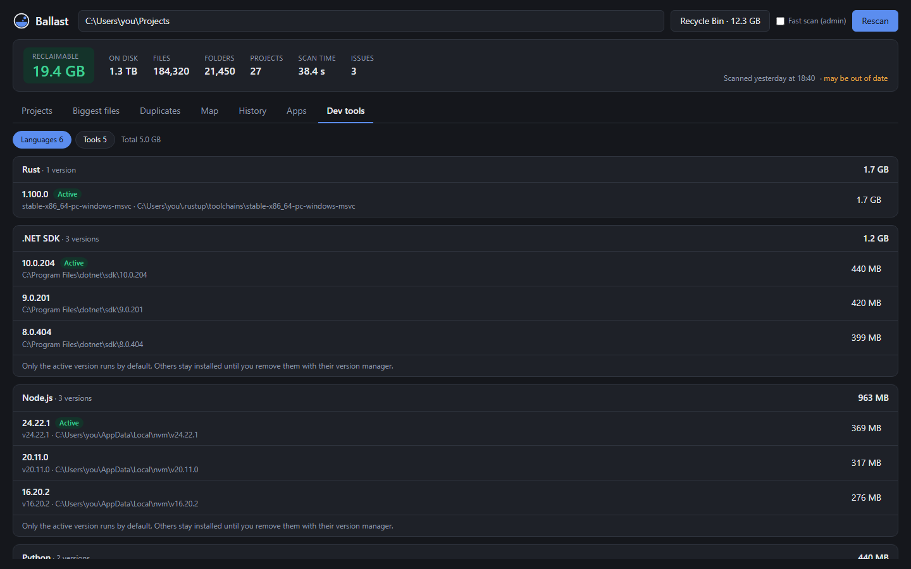

<p align="center">
  <picture>
    <source media="(prefers-color-scheme: dark)" srcset="logos/final/lockup-horizontal-color-dark.svg">
    
  </picture>
</p>
<p align="center">A disk analyzer for Windows that knows which folders in your dev projects can be rebuilt, and frees them safely.</p>
<p align="center">
  <a href="LICENSE"></a>
  
</p>

<p align="center"></p>

> <p align="center">
>   &nbsp;<br>
>   ⚠️ <b>Warning:</b> All screenshots use mock data, because I'd rather not show you my actual disk 🙂<br>
>   &nbsp;
> </p>

## Contents

- [Why I Built It](#why-i-built-it)
- [The Problem It Solves](#the-problem-it-solves)
- [Quick Start](#quick-start)
- [Features](#features)
- [Technical decisions](#technical-decisions)
- [Architecture](#architecture)
- [Screenshots](#screenshots)
- [Tech stack](#tech-stack)
- [Project structure](#project-structure)
- [License](#license)

## Why I Built It

Ballast started as a weekend project, after I saw my disk almost full. There are solid tools for this already. I wanted one built around the way a developer fills a disk, so I made it for myself first.

The weekend turned into a week. In eight days it went from an empty Tauri scaffold to a full disk analyzer: it reads the NTFS file table directly, finds duplicate files by their content, and lists every SDK version installed on the machine. Every cleanup still goes to the Recycle Bin first, and can be put back.

## The Problem It Solves

Developers fill a disk in their own way. Every project you start, even the ones you drop after a weekend, keeps gigabytes of folders that one command can rebuild: `node_modules`, `target`, `.next`, `vendor`, `.venv`. Months later the disk is almost full.

- **Big folders, no context.** Disk analyzers like WizTree and WinDirStat show what's big. They can't tell you that a 600 MB folder is a React project's `node_modules` that `npm install` brings back.
- **Dev cleaners see only one side.** Tools like npkill and kondo find dependency folders, but not the rest of the disk: videos, ISOs, duplicate files, old SDK versions.
- **Deleting is scary.** Most cleaners delete for good. One wrong tick and real work is gone, like a `vendor/` folder that was committed on purpose.
- **The heaviest weight is hidden.** Old Node.js, .NET and Python versions, Docker disks and Android emulator images sit outside your projects folder, so a project cleaner never sees them.

Ballast does both jobs in one app. It's a full disk analyzer, with biggest files, a treemap and duplicates, that also understands projects. It knows what each folder is, what can be rebuilt and what must stay. Everything it removes goes to the Recycle Bin first, with a log to put it back.

---

## Quick Start

There's no installer yet, so Ballast runs from source.

**You need:** Node.js with npm, Rust 1.85 or newer (the crates use the 2024 edition), and [Tauri's Windows prerequisites](https://v2.tauri.app/start/prerequisites/).

```bash
git clone https://github.com/ChrApostolidis/disk-cleaner.git
cd disk-cleaner
npm install
npm run tauri dev      # build and open the desktop app
```

Two other ways in:

```bash
npm run dev            # the UI in a browser at http://localhost:1420, with mock data
cargo run -p devdisk-cli -- scan "C:\Users\you\Projects"   # the CLI: biggest folders and projects in a folder
```

The CLI also takes `--top <N>` (how many folders to list, 15 by default) and `--mft` (read the NTFS file table directly, from an administrator terminal).

## Features

### Projects

- **Framework labels**: projects are recognized and named by framework, like "React project: my-shop", with the version when it's known. The rules live in [`rules.json`](crates/devdisk-core/rules.json).
- **Rebuildable folders**: each project card shows which folders can be recreated (`node_modules`, `target`, `.next`, `vendor`, `.venv`, ...) and how much space they take.
- **Committed folders stay safe**: a folder tracked by git, like a committed `vendor/` or `dist/`, is never offered for cleanup, even if its name matches.

### Cleanup

- **Preview first**: every cleanup shows what goes and how much space it frees before anything moves.
- **Recycle Bin by default**: files are moved, not deleted. Every cleanup is logged, and **Put back** in the History tab restores it.
- **Reinstall dependencies**: after removing a project's dependency folder, like `node_modules`, one button runs the project's install command again and shows its output.
- **Empty the Recycle Bin**: from inside the app, behind a second confirmation that says it's permanent.

### Finding space

- **Biggest files**: a sortable list of the largest files, sharing the same search bar.
- **Search**: words, wildcards (`*.mp3`), exact phrases (`"two words"`), size (`>500MB`) and age (`older:90d`), combined freely.
- **Map**: a treemap of the scanned folder, colored by framework, with an optional free-space block.
- **Duplicates**: files of 1 MB or more matched by content (size, then a partial hash, then a full hash), so only real copies match. You can never tick every copy of a file.

### Your machine

- **Apps**: installed desktop and Microsoft Store apps with size, publisher, version and install date. Read-only, with "Show in Explorer".
- **Dev tools**: installed languages (Node.js, Python, Java, .NET SDK, Rust, Go, PHP) with every version and which one is active, plus tools like Git, Docker, WSL and VS Code with the size of their data folders.

### Scanning

- **Size on disk**: the main number is what a delete actually frees. Cloud-only OneDrive files count as 0, compressed files count their compressed size.
- **Fast scan (admin)**: reads the NTFS Master File Table directly. All of C: (1.9 million files) took 16.6 s on my machine.
- **Saved scan**: the last scan reloads at startup, shown with its age ("Scanned yesterday at 18:40"). Cleanup re-checks the real disk before moving anything, so an old scan is still safe to act on.

## Technical decisions

These are the decisions worth knowing, and why:

- **Tauri over Electron.** A browser sandbox can't read the whole disk or move files, so it had to be a desktop app. Tauri gives a small installer and a Rust backend that's fast at walking folders in parallel. The price is Rust's learning curve.
- **Recycle Bin and Put back, never a direct delete.** Every cleanup moves files to the Recycle Bin and is logged, so it can be undone. Emptying the bin is the one permanent action, and it asks twice.
- **Git-tracked folders are never offered.** A folder named `vendor` or `dist` is usually rebuildable, but not when it's committed. Ballast checks git before offering it, because deleting tracked files loses real work.
- **Size on disk, not file size.** It's what a delete actually frees. A cloud-only OneDrive file shows its full size in Explorer but frees nothing.
- **Duplicates by content.** Matching by name gives false positives. Files are compared by size, then by a partial hash, then by a full hash. You can never select every copy, so one copy always stays.
- **Fast scan through a helper, not an admin window.** Reading the MFT needs administrator rights, but an elevated window would block drag and drop and run cleanups as admin. So the app starts a copy of itself through one UAC prompt, and that copy reads the MFT and hands back the result. The MFT parser is Ballast's own: it reads the table in large sequential chunks, which is what makes it fast.

## Architecture



The core crate has no Tauri code, so the desktop app and the CLI share the same scanner, rules and cleanup.

## Screenshots

> <p align="center">
>   &nbsp;<br>
>   ⚠️ <b>Warning:</b> All screenshots use mock data, because I'd rather not show you my actual disk 🙂<br>
>   &nbsp;
> </p>

### Map

<p align="center"></p>

### Duplicates

<p align="center"></p>

### Dev tools

<p align="center"></p>

## Tech stack

- **App:** [Tauri 2](https://v2.tauri.app), with the dialog and opener plugins
- **Backend:** Rust, with [jwalk](https://crates.io/crates/jwalk) and [rayon](https://crates.io/crates/rayon) for parallel scanning, [trash](https://crates.io/crates/trash) for the Recycle Bin, [blake3](https://crates.io/crates/blake3) for duplicate hashing, SQLite ([rusqlite](https://crates.io/crates/rusqlite)) for the cleanup log, and [clap](https://crates.io/crates/clap) for the CLI
- **Frontend:** React and TypeScript on [Vite](https://vite.dev), with [d3-hierarchy](https://d3js.org/d3-hierarchy) for the treemap and [TanStack Virtual](https://tanstack.com/virtual) for long lists

## Project structure

```
crates/devdisk-core/   scanners (walk and MFT), project detection, rules.json, duplicates, cleanup and its log
crates/devdisk-cli/    the devdisk command-line tool
src-tauri/             the Tauri app: commands the UI calls, and the elevated fast-scan entry point
src/                   the React UI, one component per tab, with mock data for the browser preview
logos/                 the Ballast logo, lockups and app icon
docs/media/            README screenshots
```

## License

[MIT](LICENSE)
