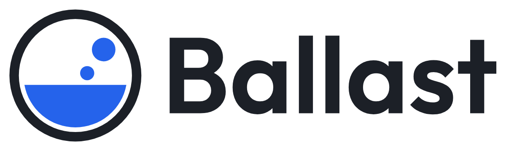

# Ballast logo

**The idea:** a porthole with the water held low and two bubbles rising. Ballast is the weight a ship carries low to stay steady, and the weight a balloon drops to rise. The app does both: it drops what can be rebuilt, and every cleanup can be put back.

## Colors

The logo uses the app's own palette (`src/App.css`).

| Role | Light backgrounds | Dark backgrounds |
|---|---|---|
| Ink (ring, wordmark) | `#1c2027` | `#e8eaee` |
| Accent (water, bubbles) | `#2563eb` | `#5b8def` |
| Background it was tested on | `#ffffff` | `#15171c` |

Both colors keep at least 3:1 contrast on their background.

## Font

**Outfit 600** for the wordmark and **Outfit 400** for taglines, © 2021 The Outfit Project Authors ([Outfit-Fonts](https://github.com/Outfitio/Outfit-Fonts)), SIL Open Font License 1.1 (free for logos). In the SVGs the wordmark is outlined to paths, so the files don't need the font installed.

## Files (`final/`)

| File | Use |
|---|---|
| `symbol.svg` | Master. Ink uses `currentColor`, the accent uses `var(--accent, currentColor)`, so it follows the page's colors and falls back to one color. |
| `symbol-color-light.svg`, `symbol-color-dark.svg`, `symbol-black.svg`, `symbol-white.svg` | Fixed colors, for places that load the SVG as an image. |
| `symbol-small.svg` | 24 px and below. It has no bubbles, which blur into a speck at 16 px. |
| `favicon.svg` | Small version that switches to its dark colors with the browser's color scheme. |
| `app-icon.svg`, `app-icon-{1024,32,16}.png` | The symbol with white "glass" inside the porthole, so the dark ring still reads on a dark Windows taskbar. The source for `src-tauri/icons`. |
| `wordmark*.svg`, `lockup-horizontal*.svg`, `lockup-stacked*.svg` | Name alone, symbol + name side by side, and symbol above the name. Each has a master plus color-light, color-dark, black and white versions. |
| `symbol-{256,512,1024}.png`, `wordmark-1200.png`, `lockup-horizontal-1200.png`, `lockup-stacked-800.png` | PNG exports on a transparent background. |
| `social-preview.png` | 1280×640 for the GitHub repo card and LinkedIn. |

## Rules

- **Clear space:** keep at least the large bubble's diameter (40 units on the 256 symbol, about 16 % of its width) free around any version.
- **Minimum size:** the full symbol at 32 px, and `symbol-small.svg` below that. The horizontal lockup at 120 px wide.
- **Don't:**
  - stretch or rotate it;
  - recolor it outside the palette;
  - add shadows, gradients or outlines;
  - put the dark-ink version on a dark background.

## Tests passed

Rendered and checked:
- On light and dark backgrounds.
- At 64, 32 and 16 px.
- In one color.
- In a circle crop.
- Blurred, mirrored and rotated.
- On light and dark Windows taskbars (`#f3f3f3`, `#202020`).

The two-bubble layout replaced a single centered bubble that read as a face.

## Open items

- **Trademark:** no trademark or reverse image search done yet. Do both before launch.
- **Washing-machine look:** a round window with water and bubbles is close to common washing-machine icons. Keep an eye on whether people read it that way.
- **The installed app:** the new Tauri icons haven't been checked in the built app yet.

## Rebuilding

- `build-lockups.cjs` builds the wordmark and lockups. It needs `opentype.js` and `@fontsource/outfit` installed in a folder you pass as its first argument: `node build-lockups.cjs <folder> final/symbol.svg 600 <out>`.
- `social-preview.html` is the source of the social image. Point its `@font-face` at a local Outfit `.woff` before rendering it.
- `brief.md` records how the logo was chosen.
